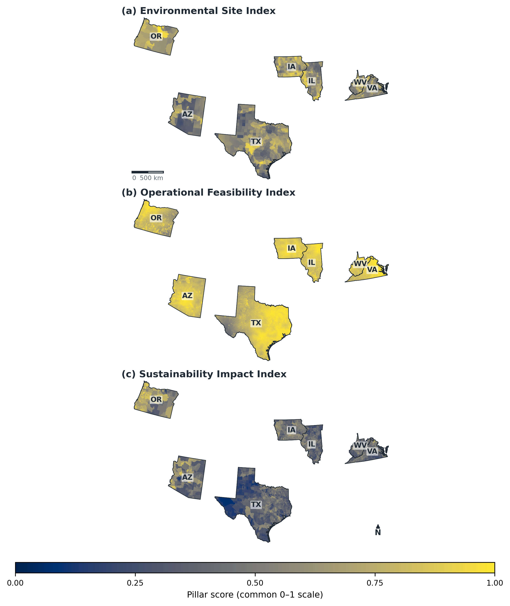

# Where Should the Next Generation of U.S. Data Centres Be Built?

## A spatial decision model for infrastructure investment, power demand and regional sustainability

This project translates an MSc dissertation at King's College London into a reproducible analytical portfolio project. It examines where large data-centre development may be comparatively suitable when infrastructure access is considered alongside physical climate exposure, electricity-system impacts and existing community burden.



## Why this matters

Cloud computing and artificial intelligence are increasing demand for electricity, water, land and supporting infrastructure. Those pressures are highly regional. Fibre access, transmission networks, environmental constraints, grid characteristics and community conditions vary considerably, while development remains concentrated in established markets shaped by power availability, cost, incentives and speed to deployment.

The model is designed for early-stage regional screening. It helps identify trade-offs before more detailed commercial, engineering, interconnection and permitting work begins.

## Analytical design

Spatial datasets from public and research sources were harmonised to a common one-kilometre grid across Arizona, Illinois, Iowa, Oregon, Texas, Virginia and West Virginia. Protected areas, mapped flood zones, open water and wetlands, and cells without sufficient developable land were excluded. The final analytical surface contained **1,477,032 viable cells**.

Nine criteria were organised into three pillars:

- **Environmental exposure:** projected water stress, extreme heat and multi-hazard exposure.
- **Operational feasibility:** proximity to high-voltage transmission, internet infrastructure and major roads.
- **Sustainability context:** grid carbon intensity, thermoelectric freshwater consumption and cumulative community burden.

Each pillar was retained alongside the composite Integrated Spatial Suitability Index (ISSI). This makes the influence of the selected criteria and weights visible, which is important because the specification reflects both research judgement and the coverage and resolution of available public data.

## Model testing

- Five Monte Carlo experiments tested 1,000 alternative weight sets over a fixed sample of 50,000 viable cells.
- An independent CRITIC weighting specification retained strong agreement with the reference ranking (**Spearman's rho = 0.952**) while changing part of the upper-decile shortlist.
- Alternative freshwater specifications produced nearly identical full-surface rankings; removing the criterion changed **9.1%** of upper-decile membership.
- Spatial validation compared 1,548 established facilities across 651 occupied cells with state-stratified random samples at one-kilometre and 25-kilometre scales.

These tests showed that the broad spatial pattern was robust, while the precise priority set remained sensitive to the objectives encoded in the weighting scheme.

## Main findings

Infrastructure access, environmental exposure and sustainability context rarely favoured the same places. Only **2.4%** of complete-data cells reached the upper quartile across all three pillars, and sustainability context was the lowest-scoring pillar in **71.1%** of cells.

Oregon recorded the highest state mean ISSI score (0.766), supported by favourable environmental and electricity-system conditions but weaker infrastructure proximity. Texas recorded the lowest mean (0.567), despite its large established market. Substantial within-state variation means these results should be interpreted as a map of trade-offs rather than a state league table.

## Repository structure

```text
code/          Python processing, modelling, sensitivity and validation scripts
figures/       Selected final maps and model-testing figures
validation/    Lightweight sensitivity outputs suitable for public review
methods/       Methodology, weighting and data-provenance documentation
qgis/          QGIS project file; source layers are not bundled
```

## Data and reproducibility

The original project integrates data from WRI, NASA CMIP6, FEMA, HIFLD, CAIDA, EPA eGRID, USGS, CDC/ATSDR, the U.S. Census and other public sources. Raw rasters, NetCDF archives, national geodatabases and other large source files are intentionally excluded from this repository.

The scripts currently preserve the original research workflow and may contain local path assumptions. A future reproducibility pass will replace those assumptions with configuration files, document software dependencies and add download or preparation instructions for each input dataset.

## Scope

This is a seven-state, early-stage regional screening model. It does not rank individual parcels, confirm interconnection availability, predict community acceptance or replace engineering, permitting and project-level diligence.

Future development could incorporate electricity prices and contracting structures, available grid capacity and interconnection timing, renewable-energy procurement, fibre bandwidth and latency, land and tax incentives, permitting timelines, and facility-specific load, cooling and water requirements. These additions would connect the regional screen more directly to project economics and hyperscale deployment feasibility.

